# ASCII Wallpapers

Live wallpapers painted in character tiles, drawn **behind the conversation** in the Claude desktop app. Type `/theme`, pick a scene, and your chat sits on top of drifting clouds, swimming koi or a summer festival at night.

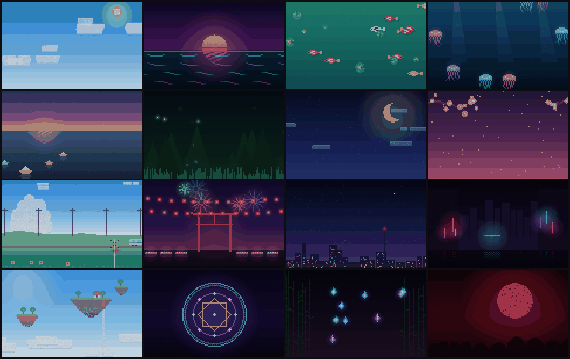

Every scene is one self-contained animated SVG: tiles are pattern-filled runs, letters are `<text>`, motion is CSS keyframes. No script runs, so the wallpaper keeps moving without any work from the session.

## Install

At the prompt of a Claude Code terminal session:

```
/plugin install ascii-wallpapers --marketplace Somazz88/ascii-wallpapers
```

Answer `y` to add the marketplace, then pick a scope (user scope loads it in every session).

From a shell:

```
claude plugin install ascii-wallpapers --marketplace Somazz88/ascii-wallpapers
```

In the desktop app, where `/plugin` does not run: click **+** next to the prompt box, then **Plugins**, **Add marketplace** with `Somazz88/ascii-wallpapers`, then **Add plugin**.

## Use

| Command | What it does |
| --- | --- |
| `/theme` or `/wallpaper` | Opens the picker above the prompt. Click a card, or press the key on it while the picker is open. **完成** closes it. |
| `/theme koi`, `/theme 樱花`, `/theme neon` | Switches straight to a scene (id, English or Chinese name, or a prefix). |
| `/theme off` | Takes the wallpaper down. |
| `/theme soft` · `normal` · `vivid` | How strongly the app's panels frost over the wallpaper. |
| `/theme colors` | The built-in colour theme picker, as before. |

Your choice is remembered across sessions. Wallpapers draw on the desktop app only; the terminal and mobile app ignore them.

## Scenes

**Calm**

| | | | |
| :-: | :-: | :-: | :-: |
| 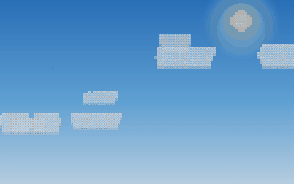 | 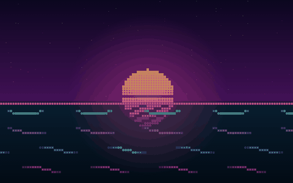 | 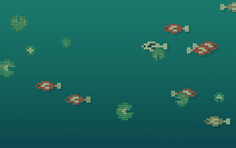 | 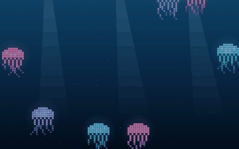 |
| `cloud` 云海漂流 | `lagoon` 霓虹泻湖 | `koi` 锦鲤池 | `jelly` 水母 |
| 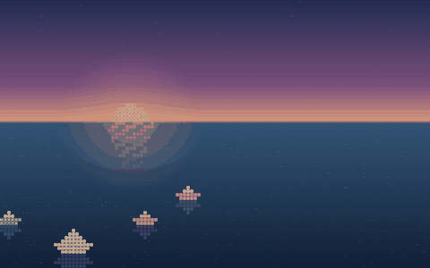 | 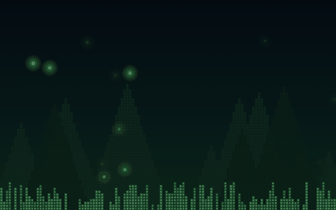 | 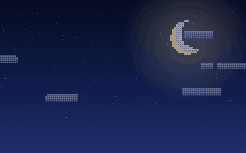 | 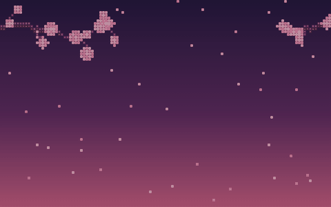 |
| `boats` 纸船 | `fireflies` 萤火虫 | `moon` 月夜 | `sakura` 樱花 |

**Anime mood**

| | | | |
| :-: | :-: | :-: | :-: |
| 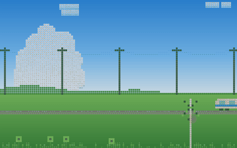 | 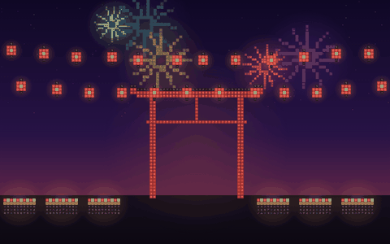 | 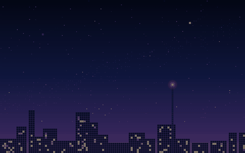 | 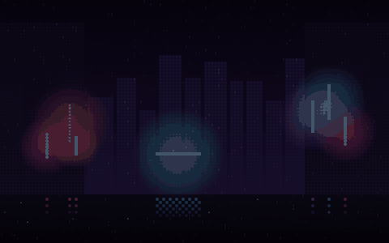 |
| `train` 夏日电车 | `matsuri` 夏日祭 | `meteor` 流星雨 | `neon` 霓虹雨夜 |
| 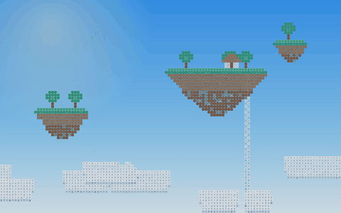 | 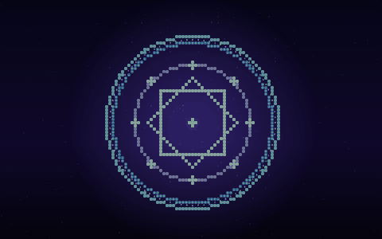 | 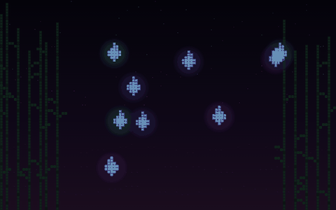 | 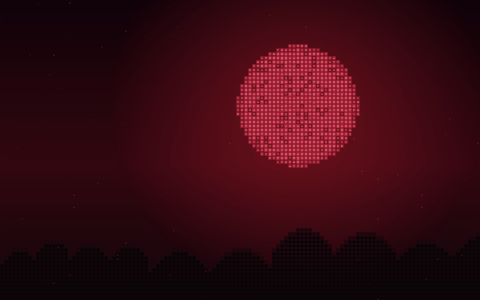 |
| `sky` 天空之岛 | `sigil` 魔法阵 | `wisp` 妖火 | `blade` 刀光血月 |

All scenes are original artwork.

## How it works

The mod uses the hooks API of Claude Code plugins:

- `$.ui.backdrop({ id, glass })` sets the session's backdrop; a `ui.render` hook on `Backdrop` answers with an `<Svg isInteractive>` of the scene, so its CSS animation runs in a sandboxed frame.
- A `ui.render` hook on `AbovePrompt` draws the picker: a live thumbnail `Svg` and a `Button` per scene.
- `/theme` is the built-in command, hooked: anything after it is about wallpapers, except `colors`, which is handed on to the original.

Adding a scene means writing one function in [`hooks/scenes.ts`](hooks/scenes.ts) that draws into the `Art` builder (`tiles`, `sprite`, `glow`, `glyph`, `move`), then listing it in `SCENES`.

## Develop

```
claude plugin validate .
claude plugin test .
```

## License

[MIT](LICENSE)
